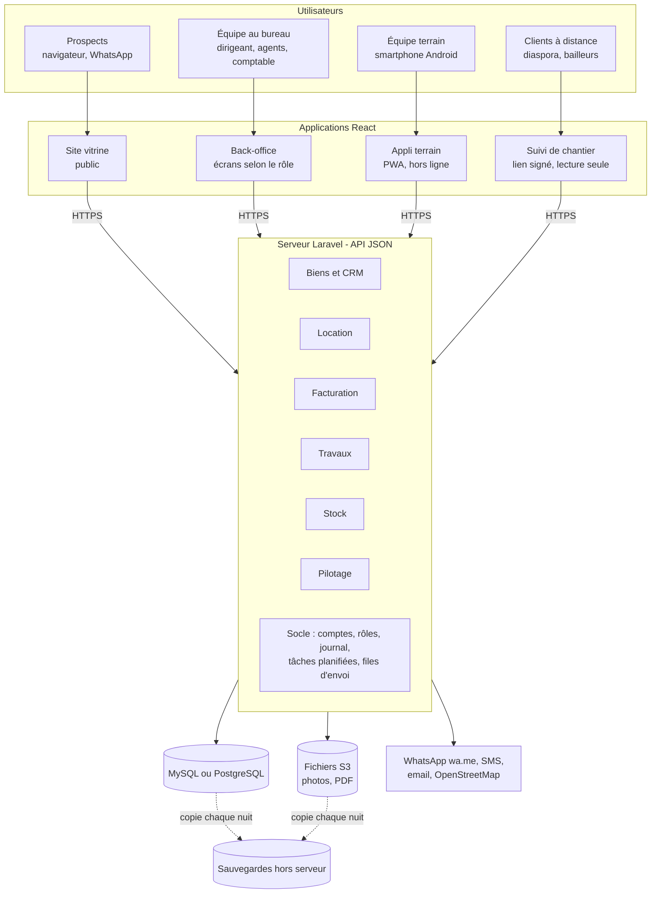

# Architecture

## Vue d'ensemble

Un seul serveur Laravel, découpé en modules (un par lot), sert quatre applications. Toutes les règles (droits, numérotation, calculs) sont écrites une seule fois, côté serveur.



Un monolithe modulaire plutôt que des microservices : 2 développeurs et un serveur à 10-25 € par mois n'ont pas besoin de plus.

## Pile technique

| Besoin | Choix | Statut |
| --- | --- | --- |
| Serveur | Laravel 13, PHP 8.3+ | En place |
| Authentification | Laravel Sanctum, jetons Bearer | En place |
| Base de données | SQLite en local et en test ; MySQL ou PostgreSQL en production | À choisir avec l'hébergement |
| Écrans | React + Vite + TypeScript + Tailwind + shadcn/ui, repris du dépôt `borom-daradji-properties` ; TanStack Query pour les appels | Back-office et site vitrine branchés sur l'API ; contenu du site paramétrable |
| Terrain | PWA installable, file de synchronisation hors ligne | Lot 3 |
| PDF | Génération côté serveur depuis des modèles HTML | Lot 2 |
| Exports | Laravel Excel | Lot 5 |
| Fichiers | Disque `public` en local, stockage compatible S3 en production ; photos en WebP | Lot 1 |
| Carte | Leaflet + OpenStreetMap | Lot 1 |
| Envois | Files Laravel (`jobs`) ; liens `wa.me` ; SMS par fournisseur local | Lots 1-2 |

Pourquoi Laravel plutôt que Spring Boot ou Node : voir [`decisions.md`](decisions.md) (D-002).

## Organisation du dépôt

```
borom-daradji/
├── CLAUDE.md                 point d'entrée pour une session Claude
├── README.md                 installation et avancement
├── docs/                     contexte, périmètre, architecture, décisions, journal
├── .github/workflows/        CI : Pint + tests du backend (ne s'exécute pas pour l'instant)
├── frontend/                 site vitrine (src/pages, src/components) et back-office (src/admin)
│   └── src/
│       ├── lib/api.ts        client de l'API : jeton, erreurs 422 par champ, téléchargements protégés
│       └── admin/            back-office : auth.tsx, hooks.ts (useMeta, useApiMutation), types.ts,
│                             components/ (mise en page, formulaires), pages/ (une page par écran)
└── backend/                  API Laravel
    ├── app/
    │   ├── Console/Commands/ commandes artisan (borom:*)
    │   ├── Enums/            valeurs métier fermées (Role…)
    │   ├── Http/
    │   │   ├── Controllers/Api/
    │   │   ├── Middleware/
    │   │   ├── Requests/     validation (une classe par action d'écriture)
    │   │   └── Resources/    format JSON des réponses
    │   ├── Models/
    │   │   └── Concerns/     traits partagés (LogsActivity)
    │   ├── Policies/         droits par modèle (Property, Client, Visit, Task)
    │   ├── Rules/            règles de validation (SenegalPhone)
    │   ├── Services/         règles métier à plusieurs étapes (statut d'un bien, rapprochement, demandes du site)
    │   └── Support/          outils sans état (PhoneNumber, ActivityLogger, Sequence, WhatsApp, ImageOptimizer)
    ├── config/borom.php      paramètres propres au projet
    ├── routes/api.php        toutes les routes de l'API
    ├── routes/console.php    tâches planifiées
    └── tests/                Feature (HTTP) et Unit
```

Quand un module grossit (lot 1 et suivants), garder cette organisation par type ; ne passer à une organisation par domaine (`app/Domain/Biens/…`) qu'en cas de besoin réel, et le noter dans `decisions.md`.

## Mécanismes transverses

### Authentification et droits
- `POST /api/auth/login` accepte `login` = email ou téléphone, `password`, `device_name` ; renvoie un jeton Sanctum (expiration : `SANCTUM_EXPIRATION` minutes, 30 jours par défaut).
- Toutes les routes protégées passent par `auth:sanctum` **et** `active` (`EnsureUserIsActive`).
- Rôles : `App\Enums\Role`, stockés en tableau JSON dans `users.roles` (cast `AsEnumCollection`). Méthodes `hasRole(Role ...$roles)`, `isDirigeant()`, scope `withRole()`.
- `Gate::before` accorde tout au dirigeant ; gate `administrate` pour les comptes, paramètres et journal.
- Modules métier : une policy par modèle (`PropertyPolicy`, `ClientPolicy`…) qui applique la matrice de droits de [`perimetre-et-lots.md`](perimetre-et-lots.md). Écritures : contrôle dans `authorize()` de la Form Request (403 avant la validation). Lectures : `Gate::authorize()` dans le contrôleur.
- Listes fermées : chaque enum (`app/Enums`) a un `label()` français ; `GET /api/meta` les expose toutes pour le front.

### Journal d'activité
- Ajouter `use LogsActivity;` à tout modèle métier : création, modification (valeurs avant/après) et suppression sont tracées avec l'utilisateur, l'IP et le navigateur.
- Les attributs `$hidden` ne sont jamais copiés (seulement « (modifié) »).
- Pour un événement qui n'est pas un CRUD (connexion, consultation d'une pièce d'identité, export) : `ActivityLogger::log('action', $sujet, 'description')`.
- Pour une mise à jour technique qui ne doit pas être journalisée : `saveQuietly()`.
- **Chaque modèle journalisé doit avoir un alias** dans `Relation::enforceMorphMap()` (`AppServiceProvider`), sinon une exception est levée. Les alias sont stockés en base : ne jamais les renommer.
- Purge quotidienne à 02:30 (`model:prune`) au-delà de `ACTIVITY_RETENTION_DAYS` jours.

### Événements de modèle : à ne pas couper
- `Property` génère sa référence et son slug (`creating`) puis sa liste de vérification foncière (`created`) ; `LogsActivity` journalise ; `Interaction` met à jour `clients.last_contact_at`.
- Ne pas utiliser `WithoutModelEvents`, `createQuietly()` ou `Model::withoutEvents()` pour créer ces modèles (le seeder de démo a buté dessus). `saveQuietly()` reste possible pour une mise à jour technique qui ne doit pas être journalisée.

### Téléphones
- `PhoneNumber::normalize()` accepte « 77 123 45 67 », « 00221… », « +221… » et renvoie `+221XXXXXXXXX`, ou `null` si ce n'est pas un numéro sénégalais à 9 chiffres commençant par 3 ou 7.
- Normaliser dans `prepareForValidation()` des Form Requests, puis valider avec `new SenegalPhone` et `unique`. Le mutateur du modèle normalise aussi, en filet de sécurité.

### Paramètres de l'entreprise
- `CompanySetting::current()` renvoie l'unique ligne (créée au premier accès). À utiliser pour les en-têtes de documents, la TVA par défaut et le site vitrine.

### Contenu du site vitrine
- Valeurs par défaut : `config/site.php`, par section (`identity`, `seo`, `contact`, `social`, `footer`, `legal`, `home`, `works`). Les modifications du dirigeant sont dans `company_settings.site` ; `SiteContent::for()` fusionne (un champ modifié remplace le défaut ; une liste modifiée remplace la liste entière).
- Ajouter un champ : l'ajouter dans `config/site.php`, sa règle dans `UpdateSiteSectionRequest`, son type dans `frontend/src/lib/site.ts`, son champ dans `src/admin/pages/SitePage.tsx`, puis l'utiliser via `useSiteData()` dans le composant public.
- Images : clé terminée par `_image`, valeur = URL https ou chemin `site/…webp` du disque public (règle `SiteImage`) ; transformées en URL pour le site public, supprimées du disque quand plus aucune section ne les utilise.
- Front public : `SiteProvider` (dans `Layout`) charge `GET /api/public/site` une fois, applique les couleurs (variables CSS), le logo en icône d'onglet et le référencement.

## Conventions

- **Langue** : code en anglais ; valeurs métier stockées en français sans accents (`responsable_travaux`, `titre_foncier`) ; commentaires, messages d'erreur et libellés en français. Chaque enum expose un `label()` en français.
- **Montants** : `bigInteger` en francs CFA entiers ; jamais de `float` pour l'argent. Taux (TVA, commission) : `decimal(5,2)`.
- **Dates** : fuseau `Africa/Dakar` (UTC+0, sans heure d'été) ; dates renvoyées en ISO 8601.
- **Réponses JSON** : toujours via une `JsonResource` ; listes paginées (25 par défaut, 50 pour le journal) ; erreurs de validation au format Laravel standard (422, `errors.champ`).
- **Validation** : une Form Request par action d'écriture ; règles métier qui croisent plusieurs champs dans `after()`.
- **Suppression** : `SoftDeletes` (archivage) pour les données métier ; désactivation pour les comptes.
- **Routes** : `routes/api.php`, groupes par niveau d'accès ; routes publiques préfixées `public/`.
- **Tests** : un test de fonctionnalité par règle métier et par restriction de droit ; `RefreshDatabase` ; `Sanctum::actingAs()` sauf quand le test a besoin d'un vrai jeton (déconnexion, changement de mot de passe).
- **Style** : Laravel Pint (preset par défaut) ; la CI échoue si `pint --test` échoue.
