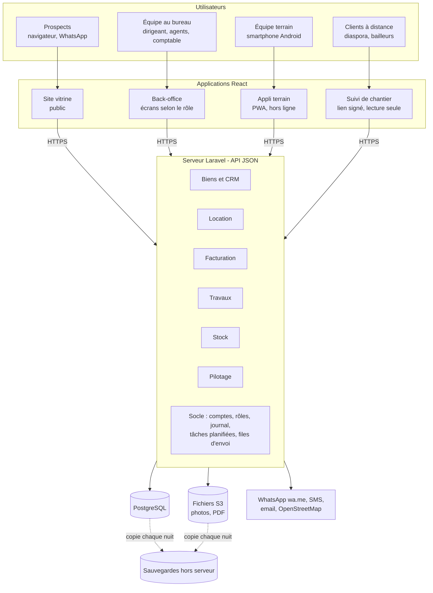

# Architecture

## Vue d'ensemble

Un seul serveur Laravel, découpé en modules (un par lot), sert quatre applications. Toutes les règles (droits, numérotation, calculs) sont écrites une seule fois, côté serveur.



Un monolithe modulaire plutôt que des microservices : 2 développeurs et un serveur à 10-25 € par mois n'ont pas besoin de plus.

## Pile technique

| Besoin | Choix | Statut |
| --- | --- | --- |
| Serveur | Laravel 13, PHP 8.3+ | En place |
| Authentification | Laravel Sanctum, jetons Bearer | En place |
| Base de données | PostgreSQL 17 avec Docker (dev et production) ; SQLite en mémoire pour les tests, SQLite fichier possible sans Docker | En place (D-039) |
| Écrans | React + Vite + TypeScript + Tailwind + shadcn/ui, repris du dépôt `borom-daradji-properties` ; TanStack Query pour les appels | Back-office et site vitrine branchés sur l'API ; contenu du site paramétrable |
| Terrain | PWA installable, file de synchronisation hors ligne | Lot 3 |
| PDF | Génération côté serveur depuis des modèles HTML | Lot 2 |
| Exports | Laravel Excel | Lot 5 |
| Fichiers | Disques `public` et `local` (privé) ; en production, volumes Docker `storage` et `storage_public` (S3 possible plus tard) ; photos en WebP | Lot 1 |
| Carte | Leaflet + OpenStreetMap | Lot 1 |
| Envois | Files Laravel (`jobs`) ; liens `wa.me` ; SMS par fournisseur local | Lots 1-2 |
| Environnement | Docker Compose : `compose.yaml` (dev), `compose.prod.yaml` (production, Caddy + PHP-FPM + PostgreSQL) ; raccourcis dans le `Makefile` | En place (D-037) |

Pourquoi Laravel plutôt que Spring Boot ou Node : voir [`decisions.md`](decisions.md) (D-002).

## Organisation du dépôt

```
borom-daradji/
├── CLAUDE.md                 point d'entrée pour une session Claude
├── README.md                 installation et avancement
├── docs/                     contexte, périmètre, architecture, décisions, journal
├── compose.yaml              Docker, développement (API, planificateur, Vite, PostgreSQL)
├── compose.prod.yaml         Docker, production (Caddy, PHP-FPM, planificateur, PostgreSQL)
├── Makefile                  raccourcis : make up, make check, make prod-up…
├── docker/                   Dockerfiles, Caddyfile, réglages PHP, scripts de démarrage
├── frontend/                 site vitrine (src/pages, src/components) et back-office (src/admin)
│   └── src/
│       ├── lib/api.ts        client de l'API : jeton, erreurs 422 par champ, téléchargements protégés
│       └── admin/            back-office : auth.tsx, hooks.ts (useMeta, useApiMutation), types.ts,
│                             components/ (mise en page, formulaires), pages/ (une page par écran)
└── backend/                  API Laravel
    ├── app/
    │   ├── Console/Commands/ commandes artisan (borom:*)
    │   ├── Enums/            valeurs métier fermées (Role…)
    │   ├── Http/
    │   │   ├── Controllers/Api/
    │   │   ├── Middleware/
    │   │   ├── Requests/     validation (une classe par action d'écriture)
    │   │   └── Resources/    format JSON des réponses
    │   ├── Models/
    │   │   └── Concerns/     traits partagés (LogsActivity)
    │   ├── Policies/         droits par modèle (Property, Client, Visit, Task)
    │   ├── Rules/            règles de validation (SenegalPhone)
    │   ├── Services/         règles métier à plusieurs étapes (statut d'un bien, rapprochement, demandes du site, Billing)
    │   └── Support/          outils sans état (PhoneNumber, ActivityLogger, Sequence, WhatsApp, ImageOptimizer, SiteContent, InvoicePdf)
    ├── config/borom.php      paramètres propres au projet
    ├── routes/api.php        toutes les routes de l'API
    ├── routes/console.php    tâches planifiées
    └── tests/                Feature (HTTP) et Unit
```

Quand un module grossit (lot 1 et suivants), garder cette organisation par type ; ne passer à une organisation par domaine (`app/Domain/Biens/…`) qu'en cas de besoin réel, et le noter dans `decisions.md`.

## Mécanismes transverses

### Authentification et droits
- `POST /api/auth/login` accepte `login` = email ou téléphone, `password`, `device_name` ; renvoie un jeton Sanctum (expiration : `SANCTUM_EXPIRATION` minutes, 30 jours par défaut).
- Toutes les routes protégées passent par `auth:sanctum` **et** `active` (`EnsureUserIsActive`).
- **RBAC** (D-034) avec `spatie/laravel-permission` : tables `roles` (+ `label`, `description`, `is_system`), `permissions`, `role_has_permissions`, `model_has_roles`, `model_has_permissions` (droits individuels). Modèles `App\Models\Role` et `App\Models\Permission` (journalisés, garde `web` : les jetons Sanctum utilisent le même fournisseur).
- **Catalogue** : `App\Support\PermissionCatalog` fait foi (permissions par module, libellés, rôles par défaut). `php artisan borom:sync-permissions` met la base en accord (à lancer après chaque déploiement ; la migration RBAC l'appelle). Les rôles modifiés par le dirigeant ne sont jamais écrasés.
- **Super-administrateur** : le rôle `dirigeant` (`PermissionCatalog::SUPER_ADMIN`) a tout, y compris les permissions futures (`Gate::before`) ; il ne se modifie pas.
- Vérifier un droit : dans une policy, `$user->hasPermission('invoices.issue')` ; ailleurs `$user->can('invoices.issue')` ou le middleware `can:settings.manage`. Une portée « les siens / toute l'équipe » = une permission `*.view_all` combinée à un test de propriété dans la policy (ex. pièces d'identité : client suivi OU `clients.documents.view_all`).
- **Ajouter une fonction** : déclarer ses permissions dans le catalogue (et, si besoin, à quels rôles par défaut les donner dans `newPermissionDefaults()`), les vérifier côté serveur, puis côté écran avec `can()` de `useAuth()` (le front reçoit `permissions` dans `/api/auth/me`).
- **Garde-fous** (`App\Support\AccessGuard`, `ValidatesAccess`) : pas d'escalade (on ne donne que les droits qu'on a), rôle dirigeant attribué ou retiré par un dirigeant seulement, on ne modifie pas ses propres droits, il reste toujours un dirigeant actif. Chaque changement de droits est journalisé avec avant/après (`permissions_changed`, `access_changed`).
- Modules métier : une policy par modèle (`PropertyPolicy`, `ClientPolicy`, `InvoicePolicy`…) traduit les actions en permissions. Écritures : contrôle dans `authorize()` de la Form Request (403 avant la validation). Lectures : `Gate::authorize()` dans le contrôleur.
- Listes fermées : chaque enum (`app/Enums`) a un `label()` français ; `GET /api/meta` les expose toutes pour le front.

### Journal d'activité
- Ajouter `use LogsActivity;` à tout modèle métier : création, modification (valeurs avant/après) et suppression sont tracées avec l'utilisateur, l'IP et le navigateur.
- Les attributs `$hidden` ne sont jamais copiés (seulement « (modifié) »).
- Pour un événement qui n'est pas un CRUD (connexion, consultation d'une pièce d'identité, export) : `ActivityLogger::log('action', $sujet, 'description')`.
- Pour une mise à jour technique qui ne doit pas être journalisée : `saveQuietly()`.
- **Chaque modèle journalisé doit avoir un alias** dans `Relation::enforceMorphMap()` (`AppServiceProvider`), sinon une exception est levée. Les alias sont stockés en base : ne jamais les renommer.
- Purge quotidienne à 02:30 (`model:prune`) au-delà de `ACTIVITY_RETENTION_DAYS` jours.

### Événements de modèle : à ne pas couper
- `Property` génère sa référence et son slug (`creating`) puis sa liste de vérification foncière (`created`) ; `LogsActivity` journalise ; `Interaction` met à jour `clients.last_contact_at`.
- Ne pas utiliser `WithoutModelEvents`, `createQuietly()` ou `Model::withoutEvents()` pour créer ces modèles (le seeder de démo a buté dessus). `saveQuietly()` reste possible pour une mise à jour technique qui ne doit pas être journalisée.

### Téléphones
- `PhoneNumber::normalize()` accepte « 77 123 45 67 », « 00221… », « +221… » et renvoie `+221XXXXXXXXX`, ou `null` si ce n'est pas un numéro sénégalais à 9 chiffres commençant par 3 ou 7.
- Normaliser dans `prepareForValidation()` des Form Requests, puis valider avec `new SenegalPhone` et `unique`. Le mutateur du modèle normalise aussi, en filet de sécurité.

### Facturation (lot 2, réutilisée aux lots 3 et 4)
- Toute écriture passe par `App\Services\Billing` : `saveDraft()` (lignes + totaux), `issue()` (numéro sans trou), `prepareCreditNote()`, `recordPayment()`, `cancelPayment()`. Les travaux et le négoce créeront leurs factures avec ces mêmes méthodes, en choisissant l'`activity`.
- Numéros : `Sequence::next('facture' | 'avoir' | 'recu')`, appelé à l'intérieur de la transaction d'émission (un échec annule aussi l'incrément).
- `invoices.paid_total` et `credited_total` sont des cumuls recalculés par le service ; le reste à payer se calcule (`Invoice::balance()`, scopes `outstanding()` et `overdue()`).
- PDF : dompdf (`barryvdh/laravel-dompdf`), modèles `resources/views/pdf/*.blade.php`, police DejaVu Sans en sous-ensemble, logo intégré en base64, couleur principale du site ; montant en lettres si l'extension `intl` est présente.

### Travaux (lot 3)
- Services : `QuoteService` (devis, modèles, envoi, acceptation, expiration), `WorksiteService` (chantiers, statuts, avancement, journal, photos, lien de suivi), `WorksBilling` (acompte, situations, solde, par `Billing`), `WorksiteTeam` (pointage, tâches, paiements des tâcherons), `SiteCash` (caisse de chantier), `WorksiteCosts` (budget prévu/réel, alerte). Les contrôleurs valident et appellent ces services ; les règles sont dans les services.
- Tout ce qui fait monter le coût d'un chantier (pointage, tâche terminée, dépense) appelle `WorksiteCosts::checkAlert()` ; une modification du budget appelle `budgetChanged()` (alerte réarmée).
- Mouvements automatiques de la caisse du jour (`CashMovementType::isAutomatic()` : caution, avance et retour de chantier) : jamais saisis à la main, exclus de la validation et de l'écran Caisse ; annulés par un mouvement inverse tant que la caisse n'est pas clôturée.
- Saisies du terrain idempotentes : `client_uuid` unique sur `worksite_photos`, `worksite_attendances` et `site_cash_entries` ; une saisie déjà reçue renvoie l'existante (200 au lieu de 201).
- Lien de suivi : `Api\Public\WorksiteTrackingController` (`/api/public/worksites/{jeton}`, limité à 60 appels/minute), page `frontend/src/pages/TrackingPage.tsx` chargée à la demande. N'y ajouter que des données que le client peut voir.

### Appli terrain hors ligne (lot 3)
- `frontend/src/admin/offline/` : `db.ts` (IndexedDB : `outbox` et `cache`), `outbox.ts` (file d'attente, envoi dans l'ordre, `useOutbox()`, `useOutboxAutoSync()` monté dans `AdminLayout`), `cachedQuery.ts` (lecture réseau d'abord, sinon dernière valeur gardée), `image.ts` (réduction des photos), `session.ts` (profil gardé pour l'usage hors ligne).
- Erreurs à l'envoi : pas de réseau, 429 ou 5xx → nouvel essai plus tard, dans le même ordre ; 401 → attente de la reconnexion ; autre refus (422, 403, 404) → saisie marquée en erreur avec le motif, les suivantes continuent.
- `frontend/public/sw.js` (enregistré en production seulement, `src/main.tsx`) : pages en « réseau d'abord » avec repli sur la dernière page d'accueil, `/assets/` gardés à la première lecture (80 au plus), `/api/` et `/storage/` jamais interceptés. Caddy sert `sw.js`, `index.html` et le manifeste en `no-cache`. Changer le nom des caches (`borom-shell-v1`…) pour forcer un nettoyage.
- Tester : `npm run build && npx vite preview` (relais `/api` vers l'API comme en dev) puis, dans Playwright, `context.setOffline(true)`.

### Stock et négoce (lot 4)
- Toute variation de stock passe par `App\Services\StockService` (`receive`, `issue`, `reverseEntry`, `adjustTo`) : verrou sur l'article, mouvement `stock_movements` (quantité et valeur signées, quantité et CMUP après), mise à jour de l'article, puis contrôle du seuil d'alerte. Ne jamais modifier `articles.quantity` ou `average_cost` ailleurs.
- Au-dessus : `PurchaseService` (achats, paiements fournisseurs), `StockOperations` (sorties vers chantier, retours, pertes, corrections), `CounterSale` (vente au comptoir par `Billing`), `InventoryService`. `WorksiteCosts` lit les mouvements `sortie_chantier` / `retour_chantier` du chantier.
- Numéros : `Sequence::next('achat' | 'inventaire')`, et `Sequence::next('article', 0)` (compteur sans année) pour `ART-0001`.
- Lignes de facture rattachables à un article (`invoice_lines.article_id`, passé par `Billing::saveDraft`).

### Paramètres de l'entreprise
- `CompanySetting::current()` renvoie l'unique ligne (créée au premier accès). À utiliser pour les en-têtes de documents, la TVA par défaut et le site vitrine.

### Contenu du site vitrine
- Valeurs par défaut : `config/site.php`, par section (`identity`, `seo`, `contact`, `social`, `footer`, `legal`, `home`, `works`). Les modifications du dirigeant sont dans `company_settings.site` ; `SiteContent::for()` fusionne (un champ modifié remplace le défaut ; une liste modifiée remplace la liste entière).
- Ajouter un champ : l'ajouter dans `config/site.php`, sa règle dans `UpdateSiteSectionRequest`, son type dans `frontend/src/lib/site.ts`, son champ dans `src/admin/pages/SitePage.tsx`, puis l'utiliser via `useSiteData()` dans le composant public.
- Images : clé terminée par `_image`, valeur = URL https ou chemin `site/…webp` du disque public (règle `SiteImage`) ; transformées en URL pour le site public, supprimées du disque quand plus aucune section ne les utilise.
- Front public : `SiteProvider` (dans `Layout`) charge `GET /api/public/site` une fois, applique les couleurs (variables CSS), le logo en icône d'onglet et le référencement.

## Conventions

- **Langue** : code en anglais ; valeurs métier stockées en français sans accents (`responsable_travaux`, `titre_foncier`) ; commentaires, messages d'erreur et libellés en français. Chaque enum expose un `label()` en français.
- **Montants** : `bigInteger` en francs CFA entiers ; jamais de `float` pour l'argent. Taux (TVA, commission) : `decimal(5,2)`.
- **Dates** : fuseau `Africa/Dakar` (UTC+0, sans heure d'été) ; dates renvoyées en ISO 8601.
- **Réponses JSON** : toujours via une `JsonResource` ; listes paginées (25 par défaut, 50 pour le journal) ; erreurs de validation au format Laravel standard (422, `errors.champ`).
- **Validation** : une Form Request par action d'écriture ; règles métier qui croisent plusieurs champs dans `after()`.
- **Suppression** : `SoftDeletes` (archivage) pour les données métier ; désactivation pour les comptes.
- **Routes** : `routes/api.php`, groupes par niveau d'accès ; routes publiques préfixées `public/`.
- **Tests** : un test de fonctionnalité par règle métier et par restriction de droit ; `RefreshDatabase` ; `Sanctum::actingAs()` sauf quand le test a besoin d'un vrai jeton (déconnexion, changement de mot de passe).
- **Style** : Laravel Pint (preset par défaut) ; `pint --test` doit passer avant chaque commit (`make check`, pas de CI, D-038).

## Environnement Docker (D-037)

Mode d'emploi dans le [`README.md`](../README.md). Ce qu'il faut savoir pour le modifier :

- **Images** : `docker/backend/Dockerfile` (cibles `dev`, `vendor`, `prod`) et `docker/frontend/Dockerfile` (cibles `dev`, `build`, `prod`). Contexte de construction : la racine du dépôt, filtré par `.dockerignore`.
- **Développement** (`compose.yaml`) : `./backend` et `./frontend` montés dans les conteneurs ; `php artisan serve --no-reload` (sans `--no-reload`, le serveur PHP perd les variables du conteneur et retombe sur `backend/.env`, donc sur SQLite) ; Vite relaie `/api` et `/storage` vers le conteneur `backend`. Les conteneurs tournent avec l'UID de la machine (`make` le transmet) pour que les fichiers créés lui appartiennent. Premier démarrage : `composer install`, `npm ci`, migrations et données de démo.
- **Tests** : `phpunit.xml` impose SQLite en mémoire par des lignes `<server>` (Laravel lit `$_SERVER` avant `$_ENV`) ; sans elles, les tests lancés dans le conteneur vidaient la base de développement. `make test-pgsql` les fait tourner sur PostgreSQL, dans la base séparée `borom_test` (créée par `docker/postgres/init-test-database.sql`). Recherches en `whereLike` (insensible à la casse sur PostgreSQL) ; ne pas comparer l'ordre des clés JSON dans les tests.
- **Production** (`compose.prod.yaml`) : `web` (Caddy : fichiers React construits, `/api` et `/up` vers PHP-FPM, `/storage` lu dans le volume `storage_public`, HTTPS automatique selon `SITE_ADDRESS`), `app` (PHP-FPM sans droits root ; au démarrage : caches de configuration, migrations, `borom:sync-permissions`), `scheduler` (`schedule:work`), `db` (PostgreSQL 17). Variables dans `.env.prod` (modèle `.env.prod.example`), journaux sur la sortie standard (`make prod-logs`).
- **Mise à jour en production** : `git pull` puis `make prod-up` (reconstruit les images ; migrations et permissions appliquées au démarrage de `app`). Sauvegarde avant : `make prod-backup`.
